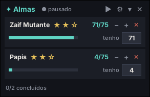

<div align="center">

# ✦ AionTrack — AION 2 ✦

### Overlay de farm, almas, DPS, Abismo, materiais e eventos

[](version.txt)
[](#requisitos)
[](LICENSE)

Criado por **@misttylol** · [Twitch](https://www.twitch.tv/misttylol)

</div>

O **AionTrack** acompanha sua sessão no AION 2 sem precisar manter menus do jogo abertos. Ele lê passivamente, pelo **Npcap**, as informações que o jogo recebe no seu próprio computador e mostra tudo em um overlay leve sobre a janela do AION 2.

<p align="center">
  
</p>

## O que o programa tem

| Área | O que mostra |
| --- | --- |
| **Almas / Pets** | Almas obtidas, progresso das estrelas, total acumulado e quanto falta para completar cada pet. |
| **DPS** | Dano e desempenho recebidos nos eventos da sessão. |
| **Abyss** | Pontos do Abismo, Kinah ganho e cronômetro de farm com iniciar, pausar e zerar. |
| **Materiais** | ODs normal, fino, puro e radiante, além dos materiais de coleta identificados. |
| **Radar de mascotes** | Mostra mascotes próximos e pontos conhecidos em Verteron, Altgard e Abismo. |
| **Agenda** | Próximo evento do servidor SA com contagem regressiva e aviso sonoro opcional. |
| **Info** | Tempo restante para o reset diário das 04:00 e o reset semanal de quarta-feira às 04:00. |

Também inclui:

- modos normal, compacto e ultracompacto;
- cores, opacidade e tamanho da fonte ajustáveis;
- identificação do personagem conectado;
- atualização automática sem perder o progresso;
- relatório de suporte com logs e configuração;
- exibição em stream pelo OBS ou Discord;
- progresso salvo somente no computador da pessoa.

## Como funciona

O Npcap observa os eventos de rede que o AION 2 já envia ao seu PC. O programa interpreta eventos de alma, inventário, combate, Pontos do Abismo, Kinah, posição e outros dados usados pelas abas.

- Não lê nem altera a memória do jogo.
- Não injeta código, não envia comandos ao servidor e não pede login.
- Não salva pacotes brutos da sua conexão.
- Em grupo, uma alma recebida por outra pessoa não entra no seu progresso.
- O chat do jogo pode ficar fechado.

> **Aviso:** este é um programa de terceiros e não oficial. A compatibilidade com o jogo e com futuras atualizações do anti-cheat não é garantida. Use por sua conta e risco.

## Instalação

1. Abra a página de [**Releases**](https://github.com/vitoriaAngelo/contadorAion2/releases/latest).
2. Baixe somente **`AionTrack-Setup.exe`** — não é necessário baixar o repositório.
3. Abra o instalador. Se o Windows mostrar uma proteção, escolha **Mais informações → Executar assim mesmo**.
4. Instale o [Npcap](https://npcap.com/) com as opções padrão quando solicitado.
5. Abra pelo atalho **AionTrack** criado na Área de Trabalho ou no Menu Iniciar.

## Como usar

1. Abra o AION 2 em **Janela sem bordas**.
2. Abra o AionTrack antes de entrar no personagem.
3. Entre no personagem e aguarde a identificação no topo do painel.
4. Comece a jogar normalmente. As informações aparecem nas abas correspondentes.

Se o contador for aberto depois do login, entre novamente no personagem para receber o progresso completo salvo pelo jogo. Os novos ganhos continuam sendo contados enquanto isso.

### Progresso de almas

Em cada pet, as estrelas douradas estão completas e a estrela contornada é a atual. Clique em uma estrela para escolher a etapa. O campo **tenho** ajusta o valor inicial daquela estrela; os botões **−** e **+** fazem correções manuais.

Exemplo: se você está na terceira estrela e possui 70 almas, clique na terceira estrela, digite `70` no campo **tenho** e pressione Enter. O painel passa a mostrar `70/75`.

### Botões principais

| Botão | Ação |
| --- | --- |
| `⏸` | Pausar ou continuar a leitura. |
| `⚙` | Abrir aparência, som, atualização e suporte. |
| `≡ / ▤` | Alternar o tamanho do painel. |
| `♪` | Ligar ou silenciar o aviso dos eventos. |
| `▾` | Recolher o conteúdo. |
| `—` | Minimizar e continuar contando. |
| `×` | Fechar o programa. |

## Eventos do servidor

O rodapé mostra o próximo evento em horário de Brasília e fica vermelho piscando no último minuto. A agenda padrão inclui Shugo Festa, Invasão Dimensional, Fenda Espaço-Temporal, Vigilante Kairah e Senhor Guardião Nahma. A lista pode ser personalizada em `config.json` na seção `eventos`.

## Mostrar no OBS

1. Adicione uma fonte **Captura de Janela**.
2. Selecione **`[pythonw.exe]: AionTrack`**.
3. Use o método **Windows 10 (1903 e superior)**.
4. No menu `⚙`, confirme que a visibilidade na stream está ligada.

## Atualizar

O programa verifica novas versões sozinho. Quando há uma atualização disponível, o botão **⬆ Atualizar** aparece no topo. Clique nele, confirme e aguarde: os arquivos são baixados, o programa reinicia e seu progresso é mantido.

Também é possível verificar manualmente em `⚙ → Procurar atualização`.

## Problemas comuns

- **Não conta nada:** confirme que o Npcap está instalado e abra o contador enquanto o AION 2 estiver conectado.
- **Valor incorreto:** ajuste com `−`, `+` ou pelo campo **tenho**.
- **Pet aparece como `Alma #ID`:** o evento foi recebido, mas o nome ainda não está no catálogo.
- **Overlay não fica sobre o jogo:** use Janela sem bordas; tela cheia exclusiva impede a sobreposição.
- **Precisa de ajuda:** use `⚙ → Gerar relatório para suporte`. O arquivo `AionTrack-relatorio.zip` será criado na Área de Trabalho.

Os detalhes de captura ficam em `diagnostico.log` na pasta instalada.

## Desinstalar

Abra **Configurações do Windows → Aplicativos → AionTrack → Desinstalar**. O desinstalador oferece a opção de guardar uma cópia do progresso na Área de Trabalho. Python e Npcap permanecem instalados.

## Requisitos

- Windows 10 ou Windows 11;
- AION 2 em Janela sem bordas;
- Npcap instalado;
- acesso à captura de rede no Windows.

## Desenvolvimento

```powershell
pip install -r requirements.txt
./RODAR.bat
```

A interface está em `contador_almas.py`. O decodificador `pet_protocol.py` foi adaptado de [aion2-pet-overlay](https://github.com/MartinLVila/aion2-pet-overlay), conforme `LICENSE-PET-PROTOCOL.txt`. Dados adicionais vêm de [aion2-pet-tracker](https://github.com/MikeZeen/aion2-pet-tracker) e [Aion-DPS-Meter](https://github.com/SkeeveAN/Aion-DPS-Meter), com as licenças correspondentes incluídas no projeto.

<div align="center">

♡ feito com carinho para a comunidade de AION 2 ♡

</div>
