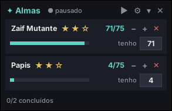

# ✦ Contador de Almas — Aion 2

Overlay para **Aion 2** que conta sozinho as almas de cada monstro que você farma e mostra o progresso de cada estrela (5 → 25 → 75 almas, dá para mudar em ⚙ → Almas por estrela), sem precisar abrir o menu de monstros.



## Como funciona

O contador lê passivamente, pelo **Npcap**, os eventos de alma que o AION 2 recebe
no seu próprio PC. Cada evento traz o identificador do pet e a quantidade recebida;
isso permite contar várias almas de uma vez sem reler o histórico do chat.

- Farmando em grupo: as almas que caem para outra pessoa ("Fulano obteve Alma: X (Vinculado)…") **não** contam para você.
- **Não** lê a memória do jogo, não envia pacotes e não pede login.
- O chat pode estar aberto ou fechado. Pacotes brutos não são salvos.
- Aparece na stream (OBS / Discord) — dá para usar como fonte de **Captura de Janela**.

> ⚠️ **Aviso:** é um programa de terceiros, não oficial. A compatibilidade com o jogo e seu anti-cheat não é garantida. Use por sua conta e risco.

## Instalar

1. Baixe o projeto: em <https://github.com/vitoriaAngelo/contadorAion2>, botão verde **Code → Download ZIP**, e extraia em qualquer pasta.
2. Dê dois cliques em **`INSTALAR.bat`**.
   - Se o Windows mostrar "O Windows protegeu o computador", clique em **Mais informações → Executar assim mesmo**.
3. Instale o [Npcap](https://npcap.com/) com as opções padrão e espere o instalador
   instalar o Python e as bibliotecas necessárias.
4. Pronto: use o ícone **Contador de Almas** na Área de Trabalho (também fica no Menu Iniciar).

Depois de instalado, a pasta que você extraiu pode ser apagada.

## Usar

- Abra o jogo em **Janela sem bordas** (em tela cheia exclusiva o overlay não aparece por cima).
- Abra o contador. Ele aguarda a conexão do AION 2; o chat pode ficar fechado.
- Mate monstros: cada alma soma no monstro certo.

Em cada monstro:

| | |
|---|---|
| ★★☆ | estrelas: douradas = completas, contorno dourado = a que você está fazendo. **Clique numa estrela** para dizer em qual você está. |
| `71/75` | almas da estrela atual |
| **tenho** [ ] | digite quantas almas você já tem **naquela estrela** e aperte Enter |
| − + | corrigir na mão |
| ✕ | tirar o monstro da lista |

Exemplo: no jogo você está na **3ª estrela** e tem **70**. Clique na 3ª estrela, digite **70**, Enter → `70/75`.

Ao entrar no personagem com o contador aberto, o Npcap traz o progresso de almas já
registrado pelo jogo. A aba **Pets** mostra o catálogo completo; a aba inicial atualiza
somente os bichos que você está acompanhando, com almas da estrela atual, total
acumulado e quantas faltam para completar. Entrar novamente no personagem permite
sincronizar esse histórico se o contador foi aberto depois do login. Fechar um bicho no
✕ o mantém fora da lista até chegar um novo drop dele.
Enquanto não receber o progresso inicial do jogo, o contador avisa para entrar novamente
no personagem; os drops novos continuam sendo contados normalmente nesse intervalo.

No rodapé aparece o **próximo evento** do jogo em dourado, com relógio em minutos:segundos
(fica **vermelho piscando** no último minuto). Agenda do servidor SA, horário de Brasília,
com base em <https://www.animoria.com.br/#agenda>: Shugo (toda hora :00), Invasão Dimensional (:30),
Fenda Espaço-Temporal (02h, 05h… 23h), Vigilante Kairah (01h, 04h… 22h) e Senhor Guardião Nahma
(21h, sexta e domingo). Dá para mudar a lista em `config.json` → `eventos`.

Botões do topo: ⏸ pausar · ⚙ menu · ▾ recolher · **–** minimizar (vai para a barra de tarefas e
continua contando; clique no ícone dele para voltar) · ✕ fechar.
O nome do personagem identificado pelo Npcap aparece ao lado do título e é atualizado
ao trocar de personagem. Se o contador abrir depois do login, mostra o último nome
salvo até receber uma nova identificação do jogo.

Botão ◆ no topo: aba **OD** — os números podem ser ajustados manualmente. A leitura de rede desta versão cobre almas de pets, ainda não OD.

Botão **Pets** no topo: aba com todos os pets catalogados, busca pelo nome,
três estrelas de progresso por pet, almas na estrela atual e quantas faltam para completar. Antes de entrar no
personagem, os valores conhecidos são os últimos salvos no computador; após a
sincronização, a lista inclui os pets com zero diretamente do estado do jogo.
Na tela inicial **Almas**, abaixo dos farms, o **Radar de mascotes** mostra um
mapinha de Verteron, Altgard ou Reshanta, aproximado da área em que você está.
Os pontos dourados menores são locais de farm conhecidos de pets pendentes;
os dourados maiores são monstros vistos ao vivo pela captura de rede. A lista
mostra o pet e quantas almas faltam. Quando
o jogo informou sua posição há menos de 10 segundos, mostra direção e distância
aproximada. Uma posição antiga permanece no mapa como referência, mas a
distância deixa de ser exibida até receber posição nova. É possível escolher o
mapa no topo do radar. Se o jogo enviar aparições de bichos sem a posição do
personagem, o radar desliza para a área aproximada conforme bichos entram e
saem do alcance e omite direção e distância. O centro vazado indica essa área
estimada, não a posição exata do personagem. Áreas sem dados de posição ou de aparição de monstros
podem mostrar apenas o mapa e os locais conhecidos.
A lista de farms na aba inicial **Almas** mostra somente os bichos em acompanhamento. A
sincronização do catálogo não coloca todos eles na lista de farm.

Botão ◷ no topo: aba **Info** com quanto falta para o reset diário (04:00) e o semanal (quarta 04:00).

Botão ≡ / ▤ no topo: modo normal ou compacto (uma linha por bicho). Botão ♪: liga/desliga o som 1 minuto antes dos eventos (riscado = mudo).

Menu ⚙: cor de destaque, tamanho da letra, som antes dos eventos, opacidade e visibilidade na stream.

## OBS

Fonte **Captura de Janela** → janela **[pythonw.exe]: Contador de Almas** → método de captura **Windows 10 (1903 e superior)**.

## Desinstalar

**Configurações → Aplicativos → Contador de Almas → Desinstalar.**
Ele pergunta se você quer guardar uma cópia do seu progresso na Área de Trabalho.
(O Python e o Npcap continuam instalados.)

## Problemas

- **Não conta nada** → confirme que o Npcap está instalado e que o contador está aberto enquanto o AION 2 está conectado. Um erro de captura aparece no topo e no `diagnostico.log` da pasta do programa.
- **Contou errado** → use − / + ou a caixinha **tenho**.
- Se o nome de um pet ainda não estiver na tabela, ele aparece como `Alma #ID` sem misturar com outro pet.
- **Pedir ajuda:** ⚙ → *Gerar relatório para suporte*. Ele cria `ContadorDeAlmas-relatorio.zip` na Área de Trabalho (log, capturas e configuração) — mande esse arquivo para quem estiver ajudando.
- **Atualizar:** ⚙ → *Procurar atualização*. Ele baixa a versão nova daqui do GitHub, fecha e abre de novo sozinho, mantendo o progresso. Quando tem versão nova, aparece **⬆** no topo do overlay (clique nele). Versões antigas (antes da 1.5.0) não têm essa opção: baixe o ZIP de novo e rode o `INSTALAR.bat` uma vez.

## Requisitos

- Windows 10 ou 11
- Npcap instalado e acesso à captura de pacotes no Windows

## Para quem quer mexer no código

```
pip install -r requirements.txt
RODAR.bat        (ou: pythonw contador_almas.py)
```

Interface em `contador_almas.py`; decodificador em `pet_protocol.py`, adaptado de
[aion2-pet-overlay](https://github.com/MartinLVila/aion2-pet-overlay) sob a licença
em `LICENSE-PET-PROTOCOL.txt`. A tabela de nomes foi derivada de
[aion2-pet-tracker](https://github.com/MikeZeen/aion2-pet-tracker).
O catálogo de monstros e pets do radar usa dados de
[Aion-DPS-Meter](https://github.com/SkeeveAN/Aion-DPS-Meter), licença MIT em
`LICENSE-RADAR.txt`.
